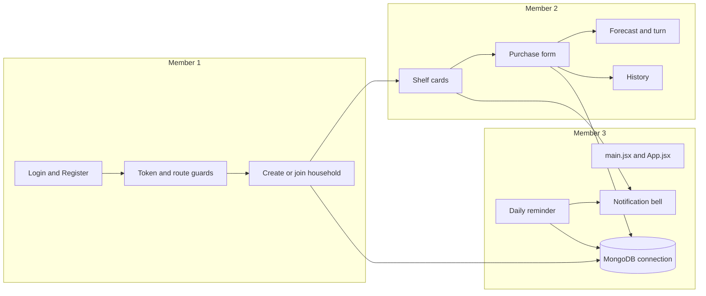
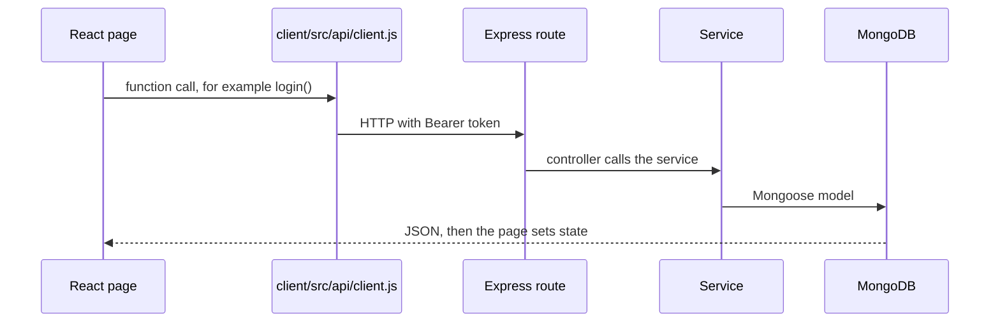
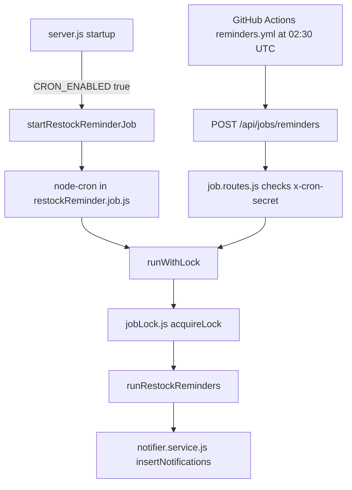

# Split Shelf — who owns what

Split Shelf is a household restock tracker. People in one flat share a shelf of items, log purchases, see whose turn it is, and get a reminder when something is about to run out.

This file is the map for a demo or a viva. Work is split across **three members**. Each member owns one vertical slice: the screen, the request, and the database tables for that slice. Shared boot files are called out so nobody points at the wrong file.

Empty placeholder files exist in the client. Do not open those. The real file is named in the tables below.

## The three members

| Member | Owns | Can answer |
| --- | --- | --- |
| **Member 1 — Accounts and households** | Sign-in, token, route guards, create/join household, invite code, members, leave | “Where is the login form?” “Where is the password checked?” “Where is the invite code?” |
| **Member 2 — Shelf, money, and history** | Item cards, “I bought this”, price in paise, forecast, whose turn, item page, History | “Where is the purchase form?” “Why is money not a decimal?” “Where is the run-out date calculated?” |
| **Member 3 — Page boot, alerts, database, scheduler** | How React mounts the page, the bell, MongoDB connection, the daily reminder, the GitHub schedule | “How does the front page render?” “Where does the app connect to the database?” “Where is the scheduler?” |

## How one click reaches the database

Every feature uses the same path. Learn this once, then only the file names change.

The shared HTTP client is `client/src/api/client.js`. It sets `baseURL` from `VITE_API_URL`, attaches `Authorization: Bearer <token>`, and turns a 401 into a logout. Pages never build URLs themselves.

The server is assembled in `server/src/app.js`:

| Mount | Route file |
| --- | --- |
| `POST/GET /api/auth/...` | `server/src/routes/auth.routes.js` |
| `/api/households/...` | `server/src/routes/household.routes.js` |
| `/api/households/:id/items/...` | `server/src/routes/item.routes.js` (mounted from the household router) |
| `/api/households/:id/history/...` | `server/src/routes/history.routes.js` |
| `/api/notifications/...` | `server/src/routes/notification.routes.js` |
| `POST /api/jobs/reminders` | `server/src/routes/job.routes.js` |

## How the front page is rendered

Member 3 owns this chain. Members 1 and 2 own the pages it lands on.

`client/index.html` has `
` and loads `client/src/main.jsx`.

`main.jsx` calls `createRoot(...).render(...)` in this order:

1. `ErrorBoundary` — if a render crashes, show a reload message (`client/src/components/ErrorBoundary.jsx`).
2. `BrowserRouter` — URL routing.
3. `AuthProvider` — who is logged in (`client/src/context/AuthContext.jsx`).
4. `ConfirmProvider` — the confirm dialog (`client/src/context/ConfirmContext.jsx`).
5. `App` — the route table (`client/src/App.jsx`).

`App.jsx` then decides the screen:

| URL | Guard | What you see | Owner |
| --- | --- | --- | --- |
| `/login`, `/register` | `PublicOnlyRoute` | Login or Register | Member 1 |
| `/` | `ProtectedRoute`, then `HouseholdLayout` | Onboarding if there is no household, otherwise Home | Member 1 gates it, Member 2 draws the shelf |
| `/items/:itemId` | same | Item detail | Member 2 |
| `/history` | same | History feed | Member 2 |
| `/history/people/:userId` | same | One person’s purchases | Member 2 |
| anything else | redirect | sent to `/` | Member 3 |

`HouseholdLayout` (`client/src/components/HouseholdLayout.jsx`) loads the household once. `HouseholdGate` inside that file shows loading, an error, `Onboarding`, or the real pages. The notification provider is mounted only after a household exists, so the bell does not poll on the login screen.

Home itself is `client/src/pages/Home.jsx`. It reads `useAuth`, `useHousehold`, and `useItems`, then draws the summary tiles, `AddItemForm`, one `ItemCard` per item, the invite code, and the member list.

## Member 1 — accounts and households

### Screens they can point at

| On screen | File | What to say |
| --- | --- | --- |
| Login form | `client/src/pages/Login.jsx` | Local state for email and password. Submit calls `useAuth().login`. Field errors come from `parseApiError`. |
| Register form | `client/src/pages/Register.jsx` | Same pattern, calls `register`. |
| Shared input | `client/src/components/Field.jsx` | Label, input, and the error under that input. |
| “Set up your shelf” | `client/src/pages/Onboarding.jsx` | Two separate forms: create a household, or join with a code. |
| Top bar name and Log out | `client/src/components/TopBar.jsx` | `useAuth()` for the name and `logout`. |
| Who may open a page | `client/src/components/RouteGuards.jsx` | `ProtectedRoute` sends guests to `/login`. `PublicOnlyRoute` sends a logged-in user away from login. |
| Auth state | `client/src/context/AuthContext.jsx` | Saves the token, calls `/auth/me` on refresh, listens for logout in another tab. |
| Household state | `client/src/context/HouseholdContext.jsx` | Loads `/households/mine`. Create, join, leave, new invite code. A 409 re-reads the household. |
| Hooks | `client/src/hooks/useAuth.js`, `client/src/hooks/useHousehold.js` | Read those contexts. Throw if used outside the provider. |

### Server files they can point at

| Question | File | Function / idea |
| --- | --- | --- |
| Register and login rules | `server/src/validators/auth.validators.js` | Zod schemas. Password length lives here, not copied in React. |
| Login route | `server/src/routes/auth.routes.js` | Wires validate + controller. |
| Login handler | `server/src/controllers/auth.controller.js` | Thin. Calls the service. |
| Password check and JWT | `server/src/services/auth.service.js` | `register`, `login`, `getMe`. |
| User table | `server/src/models/User.js` | Name, email, password hash. |
| “Is this request logged in?” | `server/src/middleware/auth.js` | `requireAuth` reads the Bearer token. |
| Create / join / leave | `server/src/services/household.service.js` | The rules: one household per user, member cap, last member deletes the household. |
| Household table | `server/src/models/Household.js` | Name, invite code, members and roles. |
| Invite code generator | `server/src/utils/inviteCode.js` | `generateInviteCode`. |
| “Is this user in this household?” | `server/src/middleware/householdMember.js` | `requireMember`, `requireAdmin`. Puts `req.household` on the request. |
| Join rate limit | `server/src/middleware/rateLimit.js` | `joinLimiter` and `authLimiter`. |
| Client calls | `client/src/api/auth.js`, `client/src/api/households.js` | Small functions over the shared axios client. |

### Questions Member 1 should be ready for

**Where is the login form logic?**  
`client/src/pages/Login.jsx`, function `handleSubmit`. It will not send a second request while `submitting` is true.

**Where is a wrong password turned into a message?**  
The server returns 401 from `auth.service.js`. The client’s `parseApiError` in `client/src/api/client.js` reads `message`. A 401 on `/auth/login` does **not** log the user out. That exception is in the response interceptor in the same file.

**Where is the token stored?**  
`tokenStore` in `client/src/api/client.js`, key `splitshelf_token`, in `localStorage`.

**Where is the invite code checked?**  
`join` in `server/src/services/household.service.js`. The form only uppercases the code in `Onboarding.jsx`.

**Why is `client/src/pages/JoinHousehold.jsx` empty?**  
Joining is the right-hand form in `Onboarding.jsx`, not that file.

**Why is `client/src/components/ProtectedRoute.jsx` empty?**  
The real guard is `ProtectedRoute` inside `client/src/components/RouteGuards.jsx`.

## Member 2 — shelf, purchases, forecast, history

### Screens they can point at

| On screen | File | What to say |
| --- | --- | --- |
| Summary tiles, add-item row, shelf, invite, members | `client/src/pages/Home.jsx` | Composes the dashboard. Shelf data comes from `useItems`. |
| Add item row | `client/src/components/AddItemForm.jsx` | Name and optional unit. |
| One item card | `client/src/components/ItemCard.jsx` | Status, last bought, next turn, forecast, and the open/close height for the form and the notes. |
| “I bought this” form | `client/src/components/PurchaseForm.jsx` | Quantity, **Price (₹)**, date, note. |
| Notes and recent buys | `client/src/components/RecentBuys.jsx` | Fetches the item detail and shows the last 3 purchases. |
| One purchase block | `client/src/components/PurchaseBlock.jsx` | Labeled cells: Quantity, Unit, Price, Bought by, Date. |
| Item page | `client/src/pages/ItemDetail.jsx` | Full history. Admin delete uses the confirm dialog. |
| History page | `client/src/pages/History.jsx` | People cards plus a day-grouped feed. |
| One person | `client/src/pages/PersonHistory.jsx` | Purchases grouped by item. |
| Coloured initial | `client/src/components/PersonName.jsx` | Hue from `client/src/utils/memberColor.js`. |
| Shelf data hook | `client/src/hooks/useItems.js` | Load, add, mark low, mark bought. Ignores an older response if a newer one is in flight. |
| Money and dates | `client/src/utils/format.js` | `rupeesToPaise`, `formatMoney`, `formatDate`, `runOutInfo`, `sortItems`. |
| Idempotency id | `client/src/utils/newKey.js` | One id per purchase attempt. Reused if the network never answers. |

### Server files they can point at

| Question | File | Function / idea |
| --- | --- | --- |
| Item list, create, low, bought, delete | `server/src/services/item.service.js` | `listItems`, `createItem`, `markLow`, `markBought`, `applyPurchaseToItem`, `toPublicItem`. |
| Purchase body rules | `server/src/validators/item.validators.js` | `boughtSchema`: idempotency key, date within a year, whole `pricePaise`. |
| Item routes | `server/src/routes/item.routes.js` | `POST /:itemId/bought` runs `boughtSchema` then the controller. |
| Item controller | `server/src/controllers/item.controller.js` | Passes `req.body` into `markBought`. |
| Item table | `server/src/models/Item.js` | Status, last buyer, next turn, cached `avgIntervalDays`, `predictedRunOutAt`, `purchaseCount`, `forecastGaps`. |
| Purchase table | `server/src/models/RestockLog.js` | Quantity, `pricePaise` (whole paise), note, `idempotencyKey`. |
| Forecast math | `server/src/services/prediction.service.js` | `computePrediction`. Needs 2 gaps of at least 1 day. Recent gaps count more. |
| Whose turn | `server/src/services/turn.service.js` | `pickNextTurn`, `resolveTurn`. |
| History feed and people | `server/src/services/history.service.js` | `getFeed`, `getPeople`, `getPerson`. |
| History query rules | `server/src/validators/history.validators.js` | Cursor shape `time_id`. |
| Client calls | `client/src/api/items.js`, `client/src/api/history.js` | |

### Questions Member 2 should be ready for

**Where is the purchase form logic?**  
`client/src/components/PurchaseForm.jsx`, `handleSubmit`. It converts the typed rupees with `rupeesToPaise` in `client/src/utils/format.js` and sends `pricePaise`. An empty price is omitted, and the screen then shows “No price”.

**Why is ₹49.50 stored as 4950?**  
Floating point cannot store 0.1 exactly. `pricePaise` is an integer. The schema in `item.validators.js` rejects decimals. `formatMoney` divides by 100 only for display.

**Where is “I bought this” saved?**  
`markBought` in `server/src/services/item.service.js`. Step 1 inserts a `RestockLog`. A duplicate `idempotencyKey` is a replay, not a second purchase. Step 2 calls `applyPurchaseToItem`, which recomputes the forecast and the purchase count from the log.

**Where is the run-out date calculated?**  
`computePrediction` in `server/src/services/prediction.service.js`. The words on the card (“Runs out in about N days”) are `runOutInfo` in `client/src/utils/format.js`, computed from that date on each render.

**Where is “whose turn”?**  
`pickNextTurn` in `server/src/services/turn.service.js`, called from `applyPurchaseToItem`. The card reads `item.nextTurn`.

**Why do cards below move up when one card opens?**  
The shelf is CSS columns, not a fixed row grid, in `client/src/styles/index.css` (`.shelf-grid`). A short card does not reserve a full empty row beside a tall one.

**Why is `LowStockButton.jsx` empty?**  
“Running low” is the button inside `ItemCard.jsx`. The request is `markLow` in `useItems.js`, which calls `item.service.js`.

## Member 3 — boot, alerts, database, scheduler

### How the page starts

Already listed under “How the front page is rendered”. Also:

| Piece | File |
| --- | --- |
| Vite port locked to 5173 | `client/vite.config.js` |
| API base URL | `client/.env` → `VITE_API_URL` |
| Confirm dialog used by Leave, New code, Delete | `client/src/context/ConfirmContext.jsx`, hook `client/src/hooks/useConfirm.js` |
| Light / dark | `client/src/components/ThemeToggle.jsx`, colours in `client/src/styles/index.css` |
| Fonts | `client/index.html` loads Outfit for headings and Source Sans 3 for body. CSS applies them on `body` and `h1, h2, h3`. |
| SPA refresh on Vercel | `client/vercel.json` rewrites every path to `index.html` |

### Bell

| On screen | File |
| --- | --- |
| Bell button and dropdown | `client/src/components/NotificationBell.jsx` |
| Poll about every 60 seconds, only while the tab is visible | `client/src/context/NotificationContext.jsx` |
| Hook | `client/src/hooks/useNotifications.js` |
| HTTP | `client/src/api/notifications.js` |
| List, unread count, mark read | `server/src/services/notification.service.js` |
| Routes | `server/src/routes/notification.routes.js` |
| Notification table | `server/src/models/Notification.js` |
| Text of a “running low” or “run out soon” alert | `server/src/services/notifier.service.js` |

`client/src/pages/Notifications.jsx` is an empty stub. The real UI is the bell.

### Database connection

This is the answer to “where do you connect to the database?”

1. `server/src/server.js` calls `connectDB()` before `app.listen`.
2. `connectDB` is in `server/src/config/db.js`. It runs `mongoose.connect(env.MONGO_URI, ...)`.
3. `MONGO_URI` is required by the schema in `server/src/config/env.js`. If it is missing, the process exits at startup.
4. Models (`User`, `Household`, `Item`, `RestockLog`, `Notification`, `JobLock`) use that one connection. There is no second database client.
5. Indexes in production are built by `server/src/scripts/syncIndexes.js` (`npm run db:indexes`), because `autoIndex` is off when `NODE_ENV` is `production`.

### Scheduler

There are two ways the daily reminder runs. Both end in the same function.

| Question | File |
| --- | --- |
| In-process clock | `server/src/jobs/restockReminder.job.js`. `startRestockReminderJob` uses `node-cron`. It is started from `server/src/server.js` only when `env.CRON_ENABLED` is true. It is **not** started from `app.js`, so tests do not start timers. |
| The work | `runRestockReminders` in the same job file. It streams items whose `predictedRunOutAt` is inside a small window. |
| “Do not run twice today” | `server/src/utils/jobLock.js` and `server/src/models/JobLock.js`. |
| Wake a sleeping host | `.github/workflows/reminders.yml` POSTs to `$API_URL/api/jobs/reminders` with header `x-cron-secret`. |
| That endpoint | `server/src/routes/job.routes.js`. If `CRON_SECRET` is unset, the route answers 404. The secret compare is a SHA-256 digest plus `timingSafeEqual`. |
| Manual one-shot | `server/src/jobs/runOnce.js`, script `npm run reminders:once`. |

On a free host, set `CRON_ENABLED=false` and let GitHub Actions call the endpoint. The lock still makes a double call harmless.

### Questions Member 3 should be ready for

**Show the code that renders the front page.**  
Open `client/src/main.jsx`, then `client/src/App.jsx`, then `client/src/components/HouseholdLayout.jsx`, then `client/src/pages/Home.jsx`.

**Where is the database connection?**  
`connectDB` in `server/src/config/db.js`, called from `start()` in `server/src/server.js`.

**Where is the scheduler?**  
`startRestockReminderJob` in `server/src/jobs/restockReminder.job.js`, plus the external trigger in `.github/workflows/reminders.yml`.

**What if two servers run the job at once?**  
`acquireLock` in `server/src/utils/jobLock.js`. The loser gets `null` and does not send a second set of alerts. Notification inserts also use a dedupe key in `notifier.service.js`.

## Files that look relevant but are empty

Do not present these as the implementation.

| Empty file | Real implementation |
| --- | --- |
| `client/src/components/ProtectedRoute.jsx` | `client/src/components/RouteGuards.jsx` |
| `client/src/components/MemberList.jsx` | The member list inside `client/src/pages/Home.jsx` |
| `client/src/components/LowStockButton.jsx` | The button inside `client/src/components/ItemCard.jsx` |
| `client/src/pages/JoinHousehold.jsx` | `client/src/pages/Onboarding.jsx` |
| `client/src/pages/Dashboard.jsx` | `client/src/pages/Home.jsx` |
| `client/src/pages/Notifications.jsx` | `client/src/components/NotificationBell.jsx` |

## What every member should be able to say

- React starts at `client/src/main.jsx`. Routes are `client/src/App.jsx`.
- Every API call goes through `client/src/api/client.js`.
- Express is built in `server/src/app.js`. The process starts in `server/src/server.js`.
- MongoDB is connected once, in `server/src/config/db.js`.
- Validation is Zod on the server. Forms display the server’s `{ field, message }` errors. They do not keep a second copy of the rules.
- Money is integer paise. The forecast is computed on the server and only worded on the client.
